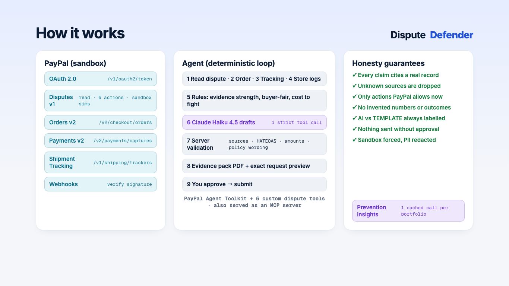

# Dispute Defender

**An honest AI agent that helps small online sellers win, or wisely settle, PayPal disputes.**

A buyer opens a PayPal dispute and a deadline starts: PayPal's help page says "You must respond within the first 10 days following a dispute creation" ([PayPal Help Center](https://www.paypal.com/us/cshelp/article/how-do-i-respond-to-%E2%80%98item-not-received%E2%80%99-and-%E2%80%98significantly-not-as-described%E2%80%99-disputes-help1083)).¹ Dispute Defender:

1. reads the case from PayPal;
2. gathers the seller's evidence (order, payment, tracking at PayPal, carrier scans, store and chat logs);
3. decides whether to **fight, offer, or refund**, with reasons;
4. drafts the response with Claude, where every claim links to its source;
5. shows exactly what PayPal will receive;
6. submits through PayPal's Disputes API **only after the seller approves**.

It also tells you when to pay instead of fight (the buyer is right, or you can't prove delivery), and finds patterns that prevent the next dispute.

**The agent's call on the demo store's 7 cases (Replay data, fixed rules, no AI):** defend 2 ($401, both won by sandbox test decisions we triggered) · fair offer 1 ($64, offering $32 back) · refund 3 ($80: 1 where the buyer is right, 1 where the seller can't prove delivery because there is no tracking on record, 1 where the seller's time costs more) · hold 1 ($142: the package is still on its way, so there is nothing PayPal can receive yet). The board shows this card.

**By hand vs with the agent (an assumption, not a measurement):** working all 7 cases by hand would take about 7 × 30 min ≈ 3.5 hours, if each takes ~30 min (the same assumption the app uses for the cost to fight). With the agent, the seller reads each verdict, its reasons and the exact request, then approves; we have not timed that.

Built for the PayPal AI Hackathon. PayPal **sandbox** only.

¹ *Deadlines:* each case also carries PayPal's own due date (`seller_response_due_date`), and the app counts down to that date. On our sandbox inquiries PayPal set it 20 days after opening, which is why the case chips read "19d … at snapshot" rather than 10 days.

*Transparency: built with AI coding assistance. The video voiceover is synthetic (Kokoro TTS).*



## Try it in 60 seconds (no login)

**Hosted demo (Replay mode, no login):** https://dispute-defender-vz4eriizbq-uc.a.run.app

**Demo video (2:33):** https://youtu.be/iJCxNgAvWto

Or run it locally:

```bash
npm ci && npm run build && npm start      # http://localhost:3000, Replay mode, no keys needed
```

1. **Case board:** $ at risk, whose move it is, and your next deadline. Your-move cases come first, then $ × urgency. Closed cases say how they were decided ("Sandbox test decision (we triggered it)").
2. **"Watch the agent work a case":** the $312 café case from the video (`PP-R-FWW-10190477`), replayed as it stood **before PayPal's decision** (a banner says so, and what happened next). The 9-step trace runs, and records from PayPal, the carrier and your store drop into the case file.
3. **The case file closes:** each claim is tied to its record by a drawn line, and the **DEFEND** stamp lands (other cases: OFFER, REFUND, or **HOLD** when there is nothing PayPal can receive yet, e.g. a package still in transit). **"Test our checker"** injects two made-up claims and shows the server striking them out.
4. **Response:** an AI-written draft (labelled *recorded*: a real Claude run, replayed at $0). Tap a source ("USPS scan · Delivered 7 Oct") to jump to the record. The button reads **Approve · send evidence** (in Replay nothing is sent).
5. **"What PayPal receives":** the exact request (`POST …/provide-supporting-info`, the JSON) and the evidence-pack PDF (Open PDF).
6. **"…and one where a fair offer is the smart call ($64.00)":** chipped mugs. The agent offers a partial refund, and the buyer wrote in Spanish, so the message to her is in Spanish with an English gloss.
7. **Verify (`/verify`):** a 5-minute path for judges: the evidence behind each of the 7 calls (proof on file, score arithmetic, the deciding fact), links to the cases where the agent does not just defend, and the safety gates with the test file that proves each.
8. **Insights:** patterns across your cases, each with its cases, and what to change, plus lessons from single cases (an incomplete address that sent a package back; a shipment without tracking), labelled Template. You approve everything.

Replay uses recorded, redacted responses from the real PayPal sandbox. Carrier scans come from a mock carrier and store logs are sample data; both are labelled wherever they appear.

## What's different

- **It argues against its own user when the evidence says so.** If the buyer is right, or the seller can't prove delivery (no tracking on record), it recommends a refund (REFUND); if there is nothing PayPal can receive yet, it holds (HOLD) instead of sending weak evidence.
- **It maps each PayPal reason code to the proof that answers it, and shows its arithmetic.** For "item not received" that is proof of shipment, a delivery scan, delivery to the order's address and (optional) a signature; for "not as described", the listing and photos before shipping. Each proof is marked on file, missing, not yet, or *shows the opposite*, with its record and the Disputes API `evidence_type` it would be filed under. The evidence score is shown as a sum (e.g. `+1 +3 +1 +1 = +6`), not a made-up win percentage. See **Proof for this claim** on any case, or all 7 at once on `/verify`.
- **Its options are exactly the actions PayPal allows on the case right now.** They come from the dispute's own HATEOAS links, and the app shows why each other allowed action was not picked.
- **A server-side checker removes AI claims it can't back up.** A claim with no record behind it, or one that predicts PayPal's decision, is struck before the seller sees the draft. Try it with **"Test our checker"** on the featured case.
- **Any AI assistant gets the same judgement, not just the raw API.** The MCP server's `assess_dispute` tool returns the agent's verdict with its reasons, each tied to a record, so an assistant can hear "refund, you can't prove delivery" before it calls a write tool. Try it with no keys: `npm run mcp:replay` (below).

## Proof: real PayPal sandbox responses

All dispute outcomes in the demo video are real responses from PayPal's sandbox Disputes API (IDs shown on screen). The café case's win comes from a sandbox-only test endpoint that we trigger (in production PayPal decides); PayPal's API then records it. We don't show PayPal's own website to avoid using its brand.

In Live mode, every approve and every sandbox decision shows a **"PayPal API response"** panel with PayPal's actual response: HTTP status, dispute ID, status/outcome and PayPal's `debug_id`, with no personal data. Any case can be re-read with **Verify with PayPal**. Disputes used in the video, for cross-checking:

| Dispute ID | What it shows | PayPal result |
|---|---|---|
| `PP-R-CMR-10190364` | Earlier test (M0, not in the video): defended, then decided by PayPal (sandbox adjudicate) | `RESOLVED · SELLER_FAVOUR` (won) |
| `PP-R-RFI-10190369` | Earlier test (M0, not in the video): decided for the buyer | `RESOLVED · BUYER_FAVOUR` (lost, $12.50 refunded) |
| `PP-R-MQR-10190375` | Earlier test (M0, not in the video): approve and submit, send-message | `200` from `POST …/send-message` |
| `PP-R-KFL-10190426` | Kiln & Clay mugs (not as described): live approve, make-offer of $32.00, 6 Oct (in the video as Replay, 1:17–1:27) | `200` from `POST …/make-offer` (debug_id `f6208691a8dc2`), re-read `UNDER_REVIEW` |
| `PP-R-FWW-10190477` | Kiln & Clay café order (not received, $312): the DEFEND case end to end, 7 Oct (video 0:27–1:17: the agent's run as Replay, then the live approve and decision from 0:55). Approve sends the note + evidence-pack PDF; then the sandbox decision, which we trigger | `200` from `POST …/provide-supporting-info` (debug_id `f1143964ab522`, re-read `UNDER_REVIEW`); `200` from `POST …/adjudicate` (sandbox test endpoint, debug_id `ca46df7dd6ffe`); then `RESOLVED · SELLER_FAVOUR` (debug_id `ca46dfc26cf8f`) |
| `PP-R-WEO-10190424` | Kiln & Clay bowl (not received, $89): an earlier DEFEND case decided in the sandbox, 6 Oct (on the board and the before/after card) | `200` from `POST …/adjudicate` (debug_id `f23189873b5c3`), then `RESOLVED · SELLER_FAVOUR` (debug_id `f503902a1d26c`) |
| `PP-R-FDW-10190427` | Kiln & Clay planter: returned to sender, the store's own fault (REFUND) | open, `UNDER_REVIEW` (Replay) |
| `PP-R-KWQ-10190429` | Kiln & Clay platter: off-camera check of provide-supporting-info (notes + a 1-page PDF), 6 Oct. The Replay snapshot of this case was recorded before that call, so in the app it shows nothing sent | `200` from `POST …/provide-supporting-info` (debug_id `f889732f476a4`); a re-read lists the note and `supporting-info.pdf` under `supporting_info`, `SUBMITTED_BY_SELLER` |
| `PP-R-VYZ-10190425`, `PP-R-OZN-10190428` | Kiln & Clay plates, vase (on the case board) | open (Replay) |

## How it uses PayPal

| PayPal API | Used for | Where |
|---|---|---|
| **OAuth 2.0** | Client-credentials token, cached server-side | `lib/paypal/client.ts` |
| **Disputes v1** | List and read disputes. Actions: provide evidence (multipart with PDF), provide supporting info (multipart with PDF, for claims PayPal is already reviewing), make offer, send message, escalate, accept claim, acknowledge return. **HATEOAS-gated**: an action is offered only if PayPal's `links` allow it right now | `lib/paypal/disputes.ts`, `lib/paypal/links.ts` |
| Disputes v1 (sandbox) | `require-evidence`, `adjudicate`: sandbox-only test endpoints. In the sandbox **we** trigger PayPal's decision (in production PayPal decides); PayPal's API then records the outcome | "Simulate PayPal's decision · SANDBOX" panel |
| **Orders v2** | The order "truth": item, amount, ship-to ZIP (redacted for the AI) | `lib/agent/gateway.ts` |
| **Payments v2** | Capture lookup (capture → order); seller-protection status; funds on hold | `lib/agent/gateway.ts` |
| **Shipment Tracking** | Tracking recorded at PayPal (Add Tracking API). Only these numbers are checked with the carrier | `lib/agent/run.ts` |
| **Webhooks** | `CUSTOMER.DISPUTE.*`, verified with `verify-webhook-signature` (fails closed). `npm run poll` is the local fallback | `app/api/webhooks/paypal` |

**PayPal Agent Toolkit.** We wrap `@paypal/agent-toolkit` with the sandbox forced; its default is *live*, and a test checks this. We extend it with **seven custom dispute tools** in the toolkit's own tool shape: provide evidence, provide supporting info, make offer, send message, escalate, accept claim with terms, acknowledge return.

`npm run mcp` serves the toolkit's read tools (disputes, orders, shipment tracking, transactions; outputs redacted), our seven tools and the agent's `assess_dispute` verdict as an **MCP server**, for Claude Desktop or any MCP client (`npm run mcp:replay` runs it keyless on the Replay data). Write tools are off unless `DD_MCP_ALLOW_WRITES=1`, and are always HATEOAS-gated.

In Live sandbox mode, the in-app agent reads disputes, orders and shipment tracking **through the Agent Toolkit**; the trace badges say "via Agent Toolkit". The capture → order lookup (Payments, not in the toolkit) uses our sandbox-forced REST client. Every write goes through our seven custom tools, HATEOAS-gated. In Replay, the same steps read recorded sandbox responses.

## Use the dispute tools from any AI assistant (MCP)

**Try it with no keys (Replay):** `npm run mcp:replay` starts a local **MCP server** (stdio) on the same recorded, redacted sandbox data as the hosted demo. No account, no network, and nothing is ever sent: a write tool returns the exact request it would send to PayPal (`"sent": false`). Claude Desktop config:

```json
{ "mcpServers": { "dispute-defender": { "command": "npm", "args": ["run", "-s", "mcp:replay"], "cwd": "/path/to/dispute-defender" } } }
```

Or use the MCP Inspector: `npx @modelcontextprotocol/inspector npm run -s mcp:replay`, then call `list_disputes`, then `assess_dispute` with `PP-R-VYZ-10190425` (refund: no tracking on record, so the seller can't prove delivery) or `PP-R-KFL-10190426` (a fair $32 offer).

Tools:

- **`assess_dispute`:** the agent's own verdict on a case (Defend / Offer / Refund / Hold / Wait), from the fixed rules with no AI call and no writes. It returns the evidence strength with its score arithmetic, the proof checklist for the case's PayPal reason code, each reason with its source record (labelled PayPal, Carrier (mock) or Store (sample)), the actions PayPal allows right now with why each was or wasn't picked, and the cost to fight.
- **Read tools:** `list_disputes`, `get_dispute` (plus the actions PayPal allows right now). With real credentials these come from the PayPal Agent Toolkit, which adds `get_order`, `get_shipment_tracking` and `list_transactions`. Outputs are redacted.
- **Our seven dispute tools:** `provide_dispute_evidence`, `provide_dispute_supporting_info`, `make_dispute_offer`, `send_dispute_message`, `escalate_dispute`, `accept_dispute_claim_with_terms`, `acknowledge_return_item`. Each runs only if PayPal currently offers that action on the dispute (HATEOAS).

**Against your own PayPal sandbox:** `npm run mcp` (server name `dispute-defender-paypal`) needs the same sandbox credentials as Live mode (`npm run paypal:key`, below, writes them to `.env.local`). Without them it stops with a message that says so and points to `npm run mcp:replay`. Write tools are refused unless you start it with `DD_MCP_ALLOW_WRITES=1`, and even then they are HATEOAS-gated and sandbox-only. `assess_dispute` reads your live sandbox disputes; carrier scans and store logs still come from the demo store's mock/sample data.

Tests: `npx vitest run tests/mcp.test.ts tests/mcp-replay.test.ts` (no network).

## How it uses AI (Claude)

| Call | When | Guarantees |
|---|---|---|
| **Draft** (Haiku 4.5, 1 call per dispute) | After the rules decide | One forced **strict** tool call. Actions are limited to what PayPal allows now, and citations to gathered evidence refs (both are schema enums). Tracking numbers come from the rules, never from the model |
| **Prevention insights** (Haiku 4.5, 1 call per portfolio, cached) | `/insights` | Actions may cite only pattern ids; any number in the AI text must exist in the cited data |

**Server validation runs on every draft, AI or template.** It:
- drops claims with unknown or missing sources;
- blocks actions PayPal doesn't currently allow, and offers above the disputed amount;
- removes tracking numbers we never gathered;
- enforces PayPal's 2000-character limits;
- removes any **policy or legal outcome** stated as fact ("Seller Protection applies", "you will win", "PayPal must…").

If an AI draft fails validation, the deterministic **TEMPLATE** draft is used and labelled as such.

Claude API spend is logged per call. The totals are in [docs/SPEND.md](docs/SPEND.md), generated by `npm run spend` (the single source of truth). Tests and the public demo cost $0 per visitor: they use the FakeProvider and the recorded drafts.

## Honesty and safety by design

- **No invented evidence.** Every claim cites a `sourceRef` (e.g. `track:USPS:9400…#ev4`), and the UI shows a chip for it.
- **Buyer-fair rules.** If the carrier returned the package, the item went to another ZIP, or the seller's own records admit a fault, the buyer is right and the agent recommends a refund. If there is no tracking on record, the seller can't prove delivery, and the agent recommends a refund too; it says exactly that, not "the buyer is right".
- **Confidence, not a fake "win %".** Evidence strength is High, Medium or Low, with reasons and the score arithmetic (each fact's weight, for or against).
- **Labels everywhere:**
  - drafts are *AI-written*, *AI-written · recorded*, or *TEMPLATE*;
  - data is *Replay* or *Live sandbox*;
  - each record is *PayPal*, *Carrier (mock)* or *Store (sample)*.
- **Human in the loop.**
  - The seller must tick "I have read this draft"; an approval record is stored **before** any write.
  - PayPal-Request-Id = approval id, so a retry can't double-submit.
  - Replay never writes.
- **Sandbox forced in three places** (env check, toolkit context, base-URL assertion), with tests.
- **Privacy.** Secrets live only in server code, and logs are scrubbed. Buyer emails, addresses, phone numbers and names are redacted before reaching the AI, the logs or the fixtures (fixtures are PII-scanned by the test suite).
- **Public demo guards.** Per-IP rate limits, a daily AI-call cap, a CSRF header on mutating routes, and "Reset demo".

## Architecture

```
Next.js 16 (App Router, TypeScript, Tailwind)
├─ app/                    dashboard · dispute detail + live trace · insights · outcomes
├─ app/api/                agent/run (SSE) · drafts/:id/{preview,pack,approve} · sandbox/simulate
│                          webhooks/paypal · disputes · demo/reset · health
├─ lib/agent/              9-step loop, trace contract, gateway (Replay | Live), validation, approval
├─ lib/paypal/             sandbox-forced client, Agent Toolkit (Live reads + MCP), 7 custom tools, HATEOAS, webhooks
├─ lib/strategy/           rules: evidence strength, proof checklist per reason code, buyer-fair, cost to fight, deadline priority
├─ lib/llm/                Claude provider (strict tool), recorded provider, budget + daily cap
├─ lib/insights/           deterministic patterns + one cached AI call
├─ lib/pdf/                evidence pack (pdf-lib)
├─ lib/mcp/                MCP server for the dispute tools
└─ fixtures/               recorded, redacted sandbox responses + recorded AI output
```

## Run locally

Requires Node ≥ 22.12.

```bash
npm ci
npm run build && npm start            # Replay mode: no keys needed
npm test                              # 400+ Vitest tests (no network, FakeProvider)
```

### Live sandbox mode (reproduces the approve flow shown in the video)

You need your own [PayPal sandbox](https://developer.paypal.com) REST app (sandbox credentials only; the app refuses anything but `api-m.sandbox.paypal.com`), with **Customer disputes** enabled, and a sandbox seller account that has disputes. Sandbox buyers can open them on sandbox.paypal.com, and `spikes/m0/` has the seeding scripts we used.

```bash
npm run paypal:key            # hidden input: PAYPAL_CLIENT_ID, PAYPAL_CLIENT_SECRET, PAYPAL_ENV=sandbox → .env.local
npm run build
DD_MODE=live npm start        # reads your real sandbox disputes (via the Agent Toolkit)
# optional: live AI drafts instead of the rules-based TEMPLATE (Claude Haiku 4.5)
npm run claude:key -- /path/to/file-with-CLAUDE_API_KEY && DD_LLM=claude DD_MODE=live npm start
```

What Live mode can write, all to the **sandbox** only, and only actions PayPal currently allows on that dispute (HATEOAS):
- **Approve and submit** (dispute page → tick "I have read this draft…" → Approve): one of send message, make offer, provide evidence (with the evidence-pack PDF), provide supporting info (note + the evidence-pack PDF, for a claim PayPal is already reviewing), accept claim, or escalate. An approval record is stored first; PayPal-Request-Id = approval id.
- **Simulate PayPal's decision** (sandbox-only panel, shown only when PayPal offers it): `require-evidence`, `adjudicate` (seller or buyer wins).
- Nothing else writes. Replay never writes.

**Other tools:**

```bash
npm run fixtures:record -- <dispute_id> order:<id> trackers:<capture_id>
npm run sandbox:sim -- <dispute_id> adjudicate SELLER_FAVOR
npm run ai:record                     # re-record the AI drafts used by Replay
scripts/video/make-story.sh           # demo video: Kokoro voice, original CC0 score, real app footage, Remotion
```

The story video is built with [Remotion](https://www.remotion.dev) (used under its free license for individuals; this is a personal hackathon entry) in `video/remotion/`. The score is original and CC0 ([docs/MUSIC_LICENSE.md](docs/MUSIC_LICENSE.md)). The live shots (the café case's approve and its sandbox decision, 7 Oct) were filmed once against the sandbox; the build reuses that footage and never writes to PayPal.

## Limitations

- **Sandbox only.** Some sandbox timings differ from production; for example, `adjudicate` becomes available about 24 min after claim evidence.
- **Demo store data:** carrier scans come from a mock carrier and store/chat logs are sample data. Real integrations would implement `CarrierAdapter` / `StoreAdapter`.
- **Transaction Search** is not used yet (sandbox indexing lag).
- **Validation scope.** The AI's wording is validated for sources, numbers and policy claims, but tone and adjectives still need the seller's review (which approval requires).
- **One instance.** Rate limits are in-memory, which is fine for the single Cloud Run instance (max instances 1).
- **Earlier test disputes.** The M0 lifecycle disputes (D1–D4) are real sandbox records and stay in the proof table, but they are archived out of the demo (`fixtures/archive/m0/`, used by tests only): their test setup reused one tracking number, which would surface as a misleading pattern. The demo board, stats and insights come from the Kiln & Clay store only.

## License

[MIT](LICENSE) © 2026 Harsha Shinde
